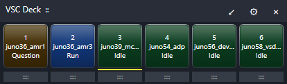
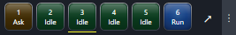

# VSC Deck

A C# / WPF, Windows-only floating overview of VS Code windows and their local
GitHub Copilot agent-host sessions. It never closes, reloads, or installs anything
in VS Code. Telemetry is read locally or from your configured Docker/SSH hosts.
There is no public network service and nothing is uploaded to external services.

## Views

### Large



Large view uses 64 x 64 physical-pixel buttons with a fixed three-line layout:
position, workspace name, and state. It also provides workspace reorder grips.
There is no title bar or Settings/Close button.

### Compact



Compact view uses 32 x 32 physical-pixel buttons without
reorder grips. Tiles show their position and status text. The narrow strip at
the right moves the panel.

### Mini

Mini view uses 20 x 20 physical-pixel buttons with only the position number:
no workspace name, status text, or session count. It retains the same status
colors, animations, hover details, and activation behavior as the larger views.
Like Compact, it has no title bar or reorder grips.

View controls appear side by side at the left, with fixed 16 x 20 physical-pixel
bounds and top alignment so they stay in place as the view changes. Up steps to a smaller view
(Large → Compact → Mini); down steps to a larger view. Both arrows remain visible
in every view: up is disabled in Mini and down is disabled in Large. Neither
control exceeds the Mini tiles' height. The arrows are vertically centered on
the Mini tiles and retain that position in Compact and Large. In those larger
views, the space below the arrows is an additional panel drag grip; Mini has
no grip below the arrows.

### Recent projects

The **+** button after the workspace buttons opens a menu of the ten most
recently accessed project identities. A project appears only once: Deck offers
its configuration with the most accumulated foreground time, even if a different
configuration was used more recently. For example, a project used longer in a
Dev Container than locally will be offered in that Dev Container. Ties prefer
the configuration accessed most recently. Accessing any configuration makes
its project recent again.
Recency determines which ten projects qualify, not their display order. Menu
entries follow the same saved relative ordering as the button bar, including
projects that are currently closed. Unordered entries follow the current bar
order, then their recorded discovery order.

Deck records configurations as they are discovered, then samples foreground
usage while running. Background windows do not accumulate time, and pauses
longer than five seconds (including suspension) are not charged. It cannot
recover usage time from before this feature was running. History retains all
observed configurations and durations; only the menu is limited to ten projects.

Reopen targets come from VS Code's standard Code/Code Insiders workspace metadata.
They retain the exact local folder or `.code-workspace` URI, SSH authority, or
Dev Container authority/configuration. Local and container variants share their
host project's identity; SSH and container-over-SSH variants share their remote
host project identity. Configured project-identity mappings are respected.
Unrelated projects are not merged merely because their names match.
If metadata is missing or ambiguous, a panel warning explains why the window
cannot yet be recorded; Deck does not guess a configuration.

Selecting a configuration that is already open uses the same activation,
maximize/restore, and Copilot Chat behavior as its workspace button or hotkey.
Otherwise Deck launches the recorded VS Code executable with **--new-window**
and the exact saved workspace URI. Existing windows are not reused or reloaded.
Only explicitly selecting a menu item activates or opens VS Code; collecting
history and opening the menu do not.

History is saved separately in `%LOCALAPPDATA%\VSCDeck\recent-projects.json`,
at most every 15 seconds while changed and on normal exit. Read/write failures
are logged and shown as panel warnings. Invalid history is left intact rather
than silently replaced.

## Using the panel

- **Dark green**: all associated live sessions are idle. The button says
  **Idle**.
- **Green blip**: a running agent has completed. Its button flashes bright
  green for 50 milliseconds, then remains dark for 0.95 seconds. The blip
  repeats until that VS Code window gains focus, whether directly, by clicking
  its button, or by using its hotkey. Large and Compact say **Done** while this
  acknowledgement is pending, then return to **Idle** after focus.
- **Blue**: at least one session is running.
- **Yellow blip**: a session has an unanswered question or permission prompt.
  Its deep amber off state is balanced against the other dark lamp colors, and
  it uses a 50-millisecond-on, 1.45-second-off cycle until the question is
  answered.
- **Gray**: workspace/status cannot be determined, or telemetry cannot be read.
- Optional user-supplied audio cues play on transition to **Run** and
  **Question**, and once when **Run** becomes **Done**. Polling, repeated flashes,
  focus acknowledgement, and initial discovery/recovery from **Unknown** do not
  replay sounds. Each cue has its own playback voice, so simultaneous cues
  (including repeated instances of the same cue) overlap without cutting off
  one another. Playback uses 30% volume relative to the Windows application
  volume; Windows Volume Mixer can adjust or mute VSC Deck independently.
  Empty sound folders are silent. Multiple WAVs in a folder or unplayable audio
  are logged and shown as a panel warning. See [Custom sound effects](#custom-sound-effects).
- Buttons use rounded glass surfaces, subtle state-colored gradients, a top
  sheen, and hover/pressed highlights at all three sizes without changing status
  colors. Each button owns its animation clocks. A running button starts its
  own prominent blue pulse when work is detected, with a randomly selected
  full cycle of 1200–1700 milliseconds and equal rise and fall times. That cycle
  stays fixed until the button leaves Run; each new entry into Run selects a
  fresh cycle. Green and yellow
  blips start when their individual completion or question event is detected,
  so buttons do not animate in lockstep.
- Hover a button for the workspace, every session, activity text, and questions.
  At 64 pixels, each button always shows exactly three lines: its position,
  workspace name, and state. At 32 pixels, the button displays its position,
  state, and active-session count. At 20 pixels, it displays only its position.
- A stripe below each button reflects an explicitly customized
  `workbench.colorCustomizations.statusBar.background` from that
  workspace's `.vscode/settings.json` (or `.code-workspace` file). The stripe
  has a one-physical-pixel gap below the button, then is two physical pixels
  high in Large view and one in Compact and Mini views. Workspaces without that
  customization retain the same transparent stripe space.
- The foreground VS Code window is identified by a small white bar centered
  along the top of its button. The marker is one physical pixel high in
  Compact and Mini views and three physical pixels high with rounded ends in Large view.
- Click a button or press its global hotkey to bring its VS Code window forward.
  VSC Deck then focuses the GitHub Copilot Chat input so you can immediately
  type or dictate. If that window is already foreground, the same action also
  toggles maximize/restore.
- In **Large** view, drag the **grip below a button** onto another button to
  reorder it. A blue insertion marker shows the resulting position, including
  positions before the first and after the last button. The marker is hidden
  when dropping would leave the button in its current position. **Compact**
  and **Mini** views hide these grips. Hotkeys follow positions, not projects. New windows
  are added in discovery order. Ordering is stored as before/after workspace
  relationships, so it survives temporarily closed workspaces. A local folder
  and its local Docker Dev Container view retain the same project position but
  remain separate buttons when both are open.
- Drag the 16-pixel strip at the right edge to move the always-on-top panel in
  any view. Right-click that strip for **Settings** or **Exit**.
- When **Snap to screen edges** is enabled in Settings, moving the panel within
  24 physical pixels of any monitor edge or the top of a bottom taskbar snaps
  it flush to the closest edge, without a gap. Equal-distance targets prefer
  the screen edge. Top, left, and right taskbars are not additional targets.
  Snapping is enabled by default.
- **Large** view uses 64 x 64 physical-pixel buttons and includes
  reorder grips, but no title bar or Settings/Close buttons. Use the up arrow to switch to
  Compact view.
- **Compact** view uses 32 x 32 physical-pixel buttons without a title bar. Use
  the down arrow to return to Large view, the up arrow to switch to Mini, or
  drag the 16-pixel strip at the
  right edge to move the panel.
- **Mini** view uses 20 x 20 physical-pixel, number-only buttons. Use the down
  arrow to return to Compact view, or the right-edge strip to move the panel.
- **Settings** selects **Large**, **Compact**, or **Mini** view and edits comma-separated,
  per-position hotkeys. Defaults are **Ctrl+Shift+1** through
  **Ctrl+Shift+9**, followed by **Ctrl+Shift+0**. Each shortcut accepts one or
  more of **Ctrl**, **Alt**, **Shift**, or **Win**, plus a digit, letter, or
  **F1** through **F24**; **F12** is reserved by Windows. At least one shortcut
  is required, and every position must have a unique shortcut. Conflicts are
  displayed, not silently ignored. Add more shortcuts if there are more than
  ten windows.
- Enable **Show in notification area instead of the taskbar** to replace the
  full taskbar button with the VSC Deck tray icon. Its menu provides
  **Show/Hide**, **Settings**, and **Exit** while the status panel keeps running.
  Double-clicking the icon restores the panel. This option is disabled by
  default.
- Enable **Start VSC Deck when I sign in to Windows** to register the current
  executable in the current user's Windows startup settings. This option does
  not require administrator rights and is disabled by default.
- **Exit** in the drag-strip or notification-area menu closes only VSC Deck.
  It does not affect any VS Code process.
- VSC Deck runs as a single instance per Windows user. Starting it again shows
  an “already running” message and exits without disturbing the existing panel.

Settings, workspace ordering, and panel position persist in
`%LOCALAPPDATA%\VSCDeck\settings.json`. Closed workspaces are retained in the saved
order. Workspace directory identities are preferred to title/project identities.
Saved 30-pixel settings from the initial version are automatically migrated to
32 pixels without changing ordering, hotkeys, or position.
Saved 16-pixel Mini settings are automatically migrated to 20 pixels.
If multiple windows open the same workspace, both reflect that workspace's
sessions; their individual order cannot reliably survive a restart.

## Status integration and limitations

This version monitors Copilot SDK/CLI **VS Code agent-host** sessions written to
`%USERPROFILE%\.copilot\session-state`. It reads their `workspace.yaml` and
`events.jsonl` incrementally, and verifies the owning process from `inuse.*.lock`
before treating a session as live. It also reads workspace folder metadata from
live `.copilot\ide` lock files without using their connection credentials.
Local polling and flashing use a 750 ms interval. Pending questions take priority over running work,
including when another session in the same workspace is idle.

Aborting a chat clears its outstanding work and questions, including when
closing or archiving the active chat emits an abort event. Shut-down sessions
and sessions without a live owner are excluded from the panel.

These are local implementation details, not a stable public Copilot telemetry
API. Traditional extension-host Copilot Chat, unconfigured remote logs, custom
VS Code profiles/data locations, and future event-format changes may have no
usable source. Such windows remain visible but show **Unknown**, never invented
idle/running state. A companion extension is not installed because VS Code does
not offer a general public API for reading another extension's internal sessions.
Logs are preferred to unreliable UI scraping. A verified remote source with no
live sessions is idle; an unavailable source is unknown.

### Dev-container and Remote-SSH windows

On every launch, VSC Deck discovers running dev containers that match open VS
Code windows and workspaces opened directly with Remote-SSH. It checks matching Docker contexts and concrete host aliases from
your existing SSH configuration, then saves the discovered sources in
`RemoteSources`. While Deck is running, newly opened windows appear automatically
at the end of the list in discovery order. An unconfigured dev-container or Remote-SSH window
also triggers background source discovery without a restart or any user action.
Status becomes available when that discovery and the first telemetry poll finish.
Unavailable sources are retried every 30 seconds while their windows remain open;
another newly seen window can trigger discovery sooner. Existing monitors keep
running during discovery. Settings also provides **Discover Docker/SSH sources**
for an immediate manual refresh. Existing entries, including
custom session roots and project identities, are retained when discovery is
refreshed. Restarting only VSC Deck also discovers newly opened containers;
no VS Code window or container needs to be restarted.

Saved sources are polled only while a matching VS Code window is open.
Closing that window suspends further checks and removes its status warnings,
without deleting the configuration. Monitoring resumes automatically when
the window reopens. A check already in progress may finish after closure,
but its result is discarded.

VSC Deck uses the already-installed Docker and OpenSSH clients, your existing
Docker context and SSH configuration, and existing Python 3 interpreters.
Local Docker monitoring requires Python 3 inside the container. For SSH-hosted
containers, the reader runs on the SSH host and uses only the container's
existing `sh`, `cat`, `stat`, `tail`, and `getconf` utilities; Python is not
required or installed inside those containers. Container event files are read
incrementally, and owner processes and start times are verified inside the
container's process namespace. SSH is batch-only: no password or authentication dialog
is opened. No extension, daemon, helper file, or package is installed in the
containers. Only container labels, session files, and process metadata are read.

For a plain `project [SSH: host]` window, discovery reads live Copilot IDE and
agent-host metadata in the SSH user's home directory to identify the workspace.
The reader runs directly on that host, without Docker or any container Python
dependency. Sessions are matched by full workspace path; ambiguous folder names
are reported instead of guessed. Python 3 is still required on the SSH host.

Containers are found by the `devcontainer.local_folder` label, not hard-coded
container IDs, so a rebuilt container can be rediscovered. Remote window titles
must match the project and Docker/SSH host.
Hyphens within the Dev Container name are supported and do not separate the
workspace from its remote annotation. Initial history reads run in the
background, without delaying discovery of local windows. Subsequent reads
transfer only new events and only the fields needed for state, descriptions,
and questions. Remote polling is every three seconds after the previous poll
completes; timeouts and unavailable hosts are shown explicitly.

SSH checks share **one persistent connection per host** instead of reconnecting
for each workspace and poll. Commands are serialized through an in-memory
Python helper launched on that connection; no helper file or service is installed.
Handshake allowance is 25 seconds, SSH keepalives run every 15 seconds, and
failed connections retry with shared 5/10/20/30-second capped backoff. Network
interruptions preserve event offsets for incremental recovery. An unavailable
connection still produces unknown status rather than stale success.
Closing VSC Deck terminates only its own SSH clients, never VS Code's existing
connections. SSH configuration and the VS Code-owned tunnel are not changed.

Sources can also be added manually to `RemoteSources` in
`%LOCALAPPDATA%\VSCDeck\settings.json` while VSC Deck is closed, then applied by
restarting **only VSC Deck**. For example:

```json
{
  "Project": "my-project",
  "Workspace": "/home/developer/work/my-project",
  "ProjectIdentity": "c:\\source\\my-project",
  "SshHost": "my-docker-host",
  "SessionRoot": "/home/vscode/.copilot/session-state"
}
```

For local Docker Desktop, omit `SshHost`, set `DockerContext` to `desktop-linux`,
and use the exact Windows directory label as `Workspace` (escaping backslashes
in JSON). `SessionRoot` is the absolute Linux path **inside** the container.
Local Docker sources automatically use their host workspace path as the
project identity for ordering. For an SSH-hosted project that also has a local
view, optionally set `ProjectIdentity` to a shared canonical path as shown
above; this preserves its position across those environments without merging
their separate buttons.
For a plain Remote-SSH workspace, set `"DirectSsh": true`, specify `SshHost` and
the absolute host `Workspace`, and set `SessionRoot` to that SSH user's host
session directory (for example, `/home/azureuser/.copilot/session-state`).
`DockerContext` is unused in this mode. Omitting `DirectSsh` preserves the
existing Docker-based behavior, including for SSH-hosted containers.
New, unconfigured windows still appear immediately with buttons and hotkeys,
but show unknown if no supported local source can be associated.

Workspace matching uses live IDE/session directory names and window titles.
Ambiguous directory names are reported rather than guessing. Session histories
without a live owning process are excluded. Windows foreground restrictions can
occasionally deny activation; VSC Deck reports that and flashes the VS Code taskbar
button instead of trying to bypass Windows focus protection.

Diagnostics are in `%LOCALAPPDATA%\VSCDeck\status.json` and `vscdeck.log`.
The status file contains local workspace/session descriptions, so treat it as
potentially sensitive. Nothing is uploaded.
Concurrent monitor messages are serialized before appending to the log. If the
log is locked or unwritable, a visible logging warning reports the file path
and diagnostic while monitoring continues. The warning clears when logging
recovers, and the most recent blocked diagnostic is recorded. Failed remote
polls are cleared before reporting their error so subsequent polls can retry.

## Build and test

Requires the .NET 10 SDK on Windows. No third-party NuGet packages are needed.

```powershell
dotnet build .\VSCDeck.App\VSCDeck.App.csproj -c Release
dotnet run --project .\VSCDeck.Tests\VSCDeck.Tests.csproj -c Release
dotnet run --project .\VSCDeck.WindowsTests\VSCDeck.WindowsTests.csproj -c Release
dotnet run --project .\VSCDeck.WindowsTests\VSCDeck.WindowsTests.csproj -c Release -- --logging-only
dotnet run --project .\VSCDeck.WindowsTests\VSCDeck.WindowsTests.csproj -c Release -- --audio-only
dotnet run --project .\VSCDeck.WindowsTests\VSCDeck.WindowsTests.csproj -c Release -- --discovery-only
dotnet run --project .\VSCDeck.WindowsTests\VSCDeck.WindowsTests.csproj -c Release -- --snapping-only
dotnet run --project .\VSCDeck.WindowsTests\VSCDeck.WindowsTests.csproj -c Release -- --pulse-only
dotnet run --project .\VSCDeck.WindowsTests\VSCDeck.WindowsTests.csproj -c Release --artifacts-path .\artifacts\validation -- --views-only
dotnet run --project .\VSCDeck.WindowsTests\VSCDeck.WindowsTests.csproj -c Release --artifacts-path .\artifacts\validation -- --mru-only
dotnet run --project .\VSCDeck.WindowsTests\VSCDeck.WindowsTests.csproj -c Release -- --runtime-discovery-live spike24_gemini_metrics
dotnet run --project .\VSCDeck.WindowsTests\VSCDeck.WindowsTests.csproj -c Release -- --container-reader-only devbox juno59_nlwf
dotnet run --project .\VSCDeck.WindowsTests\VSCDeck.WindowsTests.csproj -c Release -- --remote-lifecycle-only
dotnet run --project .\VSCDeck.WindowsTests\VSCDeck.WindowsTests.csproj -c Release -- --ssh-only devbox
dotnet publish .\VSCDeck.App\VSCDeck.App.csproj -c Release -o .\artifacts\VSCDeck
.\artifacts\VSCDeck\VSCDeck.exe
```

The published application requires the .NET 10 Windows Desktop runtime.
The dependency-free test executable returns nonzero on assertion failure.
The Windows test executable exercises actual desktop controls, mouse drag/drop,
pixel sizing, hotkey conflict reporting, persistence, and native maximize/restore
using its own disposable test windows. It does not close any VS Code windows.
Use `--local-only` to run desktop checks without relying on SSH host availability.
The focused pulse checks verify randomized cycle bounds, equal rise/fall timing,
and pulse retention and reset without interacting with VS Code or saved settings.
The focused view checks use unshown, synthetic tiles to verify all three layouts,
physical-pixel dimensions, arrow limits, animations, and Mini persistence without
interacting with VS Code. They restore saved settings afterward. The isolated
artifacts path avoids build-output locks while VSC Deck is running.
The focused MRU checks verify usage accounting, configuration grouping, the
ten-project menu limit, unbounded retained history, serialization, exact reopen
arguments, and existing-window routing without opening or activating VS Code.
The focused logging checks reproduce the original concurrent-write race and
verify serialized writes, compatible readers, exclusive locks, and recovery.
The focused audio checks use temporary synthesized fixtures to exercise
transition selection, optional sound folders, arbitrary WAV filenames,
duplicate-file reporting and recovery,
overlapping playback (audible at low volume), completed-voice cleanup, playback
errors, and shutdown cleanup without interacting with any VS Code windows.
The focused discovery checks verify new-container matching, remote-user session
roots, runtime discovery and retries, append ordering, and merging into existing
settings without interacting with VS Code.
The optional live runtime discovery check requires an open dev-container window
and its saved source; replace `spike24_gemini_metrics` with its project name.
It omits that source from a separate test monitor and verifies automatic discovery
and live telemetry without changing saved settings or interacting with VS Code.
The optional container-reader checks require a saved SSH-hosted dev-container
source with a live Copilot session and no `python3` in that container. They verify
incremental parsing with in-memory fixtures on the host, then read live container
telemetry without installing anything or interacting with VS Code.
The SSH checks use a configured host to verify connection reuse, parallel
response isolation, command error recovery, and owned-client cleanup.
The remote lifecycle checks verify that closed workspaces remain quiet and
that reopening them resumes checks, using an intentionally nonexistent Docker
context without requiring a running container or SSH host.

## Contributing, security, and license

Contributions are welcome; see [CONTRIBUTING.md](CONTRIBUTING.md) for the
Microsoft Contributor License Agreement and Code of Conduct information.
Please follow [SECURITY.md](SECURITY.md) when reporting security
vulnerabilities rather than opening a public issue. VSC Deck is available
under the [MIT License](LICENSE).

## Custom sound effects

VSC Deck distributes no audio recordings. To enable sounds, place **one WAV
file of any name** directly in each desired folder beside the executable:

```text
Assets\Sounds\run\your-sound.wav
Assets\Sounds\question\your-sound.wav
Assets\Sounds\done\your-sound.wav
```

Each folder may have its own recording. Empty or missing folders disable that
cue without warnings. Other file types and nested folders are ignored. More
than one WAV in a folder is an error: no arbitrary file is selected, and the
panel reports which folder needs attention. Invalid/unplayable recordings are
also reported. Folder contents are read at each transition, so changing a file
does not require restarting. Existing playback is allowed to finish.

For local development, put recordings in the corresponding folders under
`VSCDeck.App\Assets\Sounds`. Their contents are gitignored except for the tracked
`.gitkeep` placeholders. Local WAVs are copied into development build output,
but **never into `dotnet publish` output**. Published packages contain only
the placeholder folders; users supply their own recordings after installation.
Use a fresh publish directory when packaging, so files manually added to an
older output directory cannot be accidentally included.

Users are responsible for obtaining and using recordings under suitable
licenses. Anyone who redistributes their own configured copy must comply with
the licenses of any audio they add; gitignore does not change those obligations.
