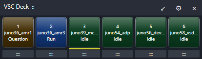
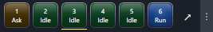

# VSC Deck

A C# / WPF, Windows-only floating overview of VS Code windows and their local
GitHub Copilot agent-host sessions. It never closes, reloads, or installs anything
in VS Code. Telemetry is read locally or from your configured Docker/SSH hosts.
There is no public network service and nothing is uploaded to external services.

## Views

### Large



Large view uses 64 x 64 physical-pixel buttons with a fixed three-line layout:
position, workspace name, and state. It also provides the title bar, settings
and close actions, workspace reorder grips, and the switch to Compact view.

### Compact



Compact view uses 32 x 32 physical-pixel buttons and removes the title bar and
reorder grips. The narrow strip at the right moves the panel, and the expand
button returns to Large view.

## Using the panel

- **Dark green**: all associated live sessions are idle. The button says
  **Idle**.
- **Green blip**: a running agent has completed. Its button flashes bright
  green for 50 milliseconds, then remains dark for 1.95 seconds. The blip
  repeats until that VS Code window gains focus, whether directly, by clicking
  its button, or by using its hotkey. Both views say **Done** while this
  acknowledgement is pending, then return to **Idle** after focus.
- **Blue**: at least one session is running.
- **Yellow blip**: a session has an unanswered question or permission prompt.
  Its deep amber off state is balanced against the other dark lamp colors, and
  it uses a 50-millisecond-on, 1.45-second-off cycle until the question is
  answered.
- **Gray**: workspace/status cannot be determined, or telemetry cannot be read.
- Buttons use rounded glass surfaces, subtle state-colored gradients, a top
  sheen, and hover/pressed highlights at both sizes without changing status
  colors. Each button owns its animation clocks. A running button starts its
  own prominent 1.2-second blue pulse when work is detected. Green and yellow
  blips start when their individual completion or question event is detected,
  so buttons do not animate in lockstep.
- Hover a button for the workspace, every session, activity text, and questions.
  At 64 pixels, each button always shows exactly three lines: its position,
  workspace name, and state. At 32 pixels, the button displays its position,
  state, and active-session count.
- A stripe below each button reflects an explicitly customized
  `workbench.colorCustomizations.statusBar.background` from that
  workspace's `.vscode/settings.json` (or `.code-workspace` file). The stripe
  has a one-physical-pixel gap below the button, then is two physical pixels
  high in Large view and one in Compact view. Workspaces without that
  customization retain the same transparent stripe space.
- The foreground VS Code window is identified by a small white bar centered
  along the top of its button. The marker is one physical pixel high in
  Compact view and three physical pixels high with rounded ends in Large view.
- Click a button or press its global hotkey to bring its VS Code window forward.
  VSC Deck then focuses the GitHub Copilot Chat input so you can immediately
  type or dictate. If that window is already foreground, the same action also
  toggles maximize/restore.
- In **Large** view, drag the **grip below a button** onto another button to
  reorder it. A blue insertion marker shows the resulting position, including
  positions before the first and after the last button. The marker is hidden
  when dropping would leave the button in its current position. **Compact**
  view hides these grips. Hotkeys follow positions, not projects. New windows
  are added in discovery order. Ordering is stored as before/after workspace
  relationships, so it survives temporarily closed workspaces. A local folder
  and its local Docker Dev Container view retain the same project position but
  remain separate buttons when both are open.
- Drag the title grip to move the always-on-top panel.
- When **Snap to screen edges** is enabled in Settings, moving the panel within
  24 physical pixels of any monitor edge snaps it flush to that edge, without a
  gap. Snapping is enabled by default.
- **Large** view uses 64 x 64 physical-pixel buttons and includes the title bar,
  settings, close button, and reorder grips. Use the ↙ title-bar button to
  switch to Compact view.
- **Compact** view uses 32 x 32 physical-pixel buttons without a title bar. Use
  the expand button to return to Large view, or drag the 16-pixel strip at the
  right edge to move the panel.
- **Settings** selects **Large** or **Compact** view and edits comma-separated,
  per-position hotkeys. Defaults are **Ctrl+Shift+1** through
  **Ctrl+Shift+9**, followed by **Ctrl+Shift+0**. Each shortcut accepts one or
  more of **Ctrl**, **Alt**, **Shift**, or **Win**, plus a digit, letter, or
  **F1** through **F24**; **F12** is reserved by Windows. At least one shortcut
  is required, and every position must have a unique shortcut. Conflicts are
  displayed, not silently ignored. Add more shortcuts if there are more than
  ten windows.
- Enable **Show in notification area instead of the taskbar** to replace the
  full taskbar button with the VSC Deck tray icon. Its menu provides
  **Show/Hide**, **Settings**, and **Exit** while the status panel keeps running.
  Double-clicking the icon restores the panel. This option is disabled by
  default.
- Enable **Start VSC Deck when I sign in to Windows** to register the current
  executable in the current user's Windows startup settings. This option does
  not require administrator rights and is disabled by default.
- **X** closes only VSC Deck. It does not affect any VS Code process.
- VSC Deck runs as a single instance per Windows user. Starting it again shows
  an “already running” message and exits without disturbing the existing panel.

Settings, workspace ordering, and panel position persist in
`%LOCALAPPDATA%\VSCDeck\settings.json`. Closed workspaces are retained in the saved
order. Workspace directory identities are preferred to title/project identities.
Saved 30-pixel settings from the initial version are automatically migrated to
32 pixels without changing ordering, hotkeys, or position.
If multiple windows open the same workspace, both reflect that workspace's
sessions; their individual order cannot reliably survive a restart.

## Status integration and limitations

This version monitors Copilot SDK/CLI **VS Code agent-host** sessions written to
`%USERPROFILE%\.copilot\session-state`. It reads their `workspace.yaml` and
`events.jsonl` incrementally, and verifies the owning process from `inuse.*.lock`
before treating a session as live. It also reads workspace folder metadata from
live `.copilot\ide` lock files without using their connection credentials.
Local polling and flashing use a 750 ms interval. Pending questions take priority over running work,
including when another session in the same workspace is idle.

Aborting a chat clears its outstanding work and questions, including when
closing or archiving the active chat emits an abort event. Shut-down sessions
and sessions without a live owner are excluded from the panel.

These are local implementation details, not a stable public Copilot telemetry
API. Traditional extension-host Copilot Chat, unconfigured remote logs, custom
VS Code profiles/data locations, and future event-format changes may have no
usable source. Such windows remain visible but show **Unknown**, never invented
idle/running state. A companion extension is not installed because VS Code does
not offer a general public API for reading another extension's internal sessions.
Logs are preferred to unreliable UI scraping. A verified remote source with no
live sessions is idle; an unavailable source is unknown.

### Existing dev-container windows

On every launch, VSC Deck discovers running dev containers that match open VS
Code windows. It checks matching Docker contexts and concrete host aliases from
your existing SSH configuration, then saves the discovered sources in
`RemoteSources`. While Deck is running, newly opened windows appear automatically
at the end of the list in discovery order. An unconfigured dev-container window
also triggers background source discovery without a restart or any user action.
Status becomes available when that discovery and the first telemetry poll finish.
Unavailable sources are retried every 30 seconds while their windows remain open;
another newly seen window can trigger discovery sooner. Existing monitors keep
running during discovery. Settings also provides **Discover Docker/SSH sources**
for an immediate manual refresh. Existing entries, including
custom session roots and project identities, are retained when discovery is
refreshed. Restarting only VSC Deck also discovers newly opened containers;
no VS Code window or container needs to be restarted.

Saved sources are polled only while a matching VS Code window is open.
Closing that window suspends further checks and removes its status warnings,
without deleting the configuration. Monitoring resumes automatically when
the window reopens. A check already in progress may finish after closure,
but its result is discarded.

VSC Deck uses the already-installed Docker and OpenSSH clients, your existing
Docker context and SSH configuration, and the hosts' and containers' existing
Python 3 interpreters. SSH is batch-only: no password or authentication dialog
is opened. No extension, daemon, helper file, or package is installed in the
containers. Only container labels, session files, and process metadata are read.

Containers are found by the `devcontainer.local_folder` label, not hard-coded
container IDs, so a rebuilt container can be rediscovered. Remote window titles
must match the project and Docker/SSH host. Initial history reads run in the
background, without delaying discovery of local windows. Subsequent reads
transfer only new events and only the fields needed for state, descriptions,
and questions. Remote polling is every three seconds after the previous poll
completes; timeouts and unavailable hosts are shown explicitly.

SSH checks share **one persistent connection per host** instead of reconnecting
for each workspace and poll. Commands are serialized through an in-memory
Python helper launched on that connection; no helper file or service is installed.
Handshake allowance is 25 seconds, SSH keepalives run every 15 seconds, and
failed connections retry with shared 5/10/20/30-second capped backoff. Network
interruptions preserve event offsets for incremental recovery. An unavailable
connection still produces unknown status rather than stale success.
Closing VSC Deck terminates only its own SSH clients, never VS Code's existing
connections. SSH configuration and the VS Code-owned tunnel are not changed.

Sources can also be added manually to `RemoteSources` in
`%LOCALAPPDATA%\VSCDeck\settings.json` while VSC Deck is closed, then applied by
restarting **only VSC Deck**. For example:

```json
{
  "Project": "my-project",
  "Workspace": "/home/developer/work/my-project",
  "ProjectIdentity": "c:\\source\\my-project",
  "SshHost": "my-docker-host",
  "SessionRoot": "/home/vscode/.copilot/session-state"
}
```

For local Docker Desktop, omit `SshHost`, set `DockerContext` to `desktop-linux`,
and use the exact Windows directory label as `Workspace` (escaping backslashes
in JSON). `SessionRoot` is the absolute Linux path **inside** the container.
Local Docker sources automatically use their host workspace path as the
project identity for ordering. For an SSH-hosted project that also has a local
view, optionally set `ProjectIdentity` to a shared canonical path as shown
above; this preserves its position across those environments without merging
their separate buttons.
New, unconfigured windows still appear immediately with buttons and hotkeys,
but show unknown if no supported local source can be associated.

Workspace matching uses live IDE/session directory names and window titles.
Ambiguous directory names are reported rather than guessing. Session histories
without a live owning process are excluded. Windows foreground restrictions can
occasionally deny activation; VSC Deck reports that and flashes the VS Code taskbar
button instead of trying to bypass Windows focus protection.

Diagnostics are in `%LOCALAPPDATA%\VSCDeck\status.json` and `vscdeck.log`.
The status file contains local workspace/session descriptions, so treat it as
potentially sensitive. Nothing is uploaded.
Concurrent monitor messages are serialized before appending to the log. If the
log is locked or unwritable, a visible logging warning reports the file path
and diagnostic while monitoring continues. The warning clears when logging
recovers, and the most recent blocked diagnostic is recorded. Failed remote
polls are cleared before reporting their error so subsequent polls can retry.

## Build and test

Requires the .NET 10 SDK on Windows. No third-party NuGet packages are needed.

```powershell
dotnet build .\VSCDeck.App\VSCDeck.App.csproj -c Release
dotnet run --project .\VSCDeck.Tests\VSCDeck.Tests.csproj -c Release
dotnet run --project .\VSCDeck.WindowsTests\VSCDeck.WindowsTests.csproj -c Release
dotnet run --project .\VSCDeck.WindowsTests\VSCDeck.WindowsTests.csproj -c Release -- --logging-only
dotnet run --project .\VSCDeck.WindowsTests\VSCDeck.WindowsTests.csproj -c Release -- --discovery-only
dotnet run --project .\VSCDeck.WindowsTests\VSCDeck.WindowsTests.csproj -c Release -- --snapping-only
dotnet run --project .\VSCDeck.WindowsTests\VSCDeck.WindowsTests.csproj -c Release -- --runtime-discovery-live spike24_gemini_metrics
dotnet run --project .\VSCDeck.WindowsTests\VSCDeck.WindowsTests.csproj -c Release -- --remote-lifecycle-only
dotnet run --project .\VSCDeck.WindowsTests\VSCDeck.WindowsTests.csproj -c Release -- --ssh-only devbox
dotnet publish .\VSCDeck.App\VSCDeck.App.csproj -c Release -o .\artifacts\VSCDeck
.\artifacts\VSCDeck\VSCDeck.exe
```

The published application requires the .NET 10 Windows Desktop runtime.
The dependency-free test executable returns nonzero on assertion failure.
The Windows test executable exercises actual desktop controls, mouse drag/drop,
pixel sizing, hotkey conflict reporting, persistence, and native maximize/restore
using its own disposable test windows. It does not close any VS Code windows.
Use `--local-only` to run desktop checks without relying on SSH host availability.
The focused logging checks reproduce the original concurrent-write race and
verify serialized writes, compatible readers, exclusive locks, and recovery.
The focused discovery checks verify new-container matching, remote-user session
roots, runtime discovery and retries, append ordering, and merging into existing
settings without interacting with VS Code.
The optional live runtime discovery check requires an open dev-container window
and its saved source; replace `spike24_gemini_metrics` with its project name.
It omits that source from a separate test monitor and verifies automatic discovery
and live telemetry without changing saved settings or interacting with VS Code.
The SSH checks use a configured host to verify connection reuse, parallel
response isolation, command error recovery, and owned-client cleanup.
The remote lifecycle checks verify that closed workspaces remain quiet and
that reopening them resumes checks, using an intentionally nonexistent Docker
context without requiring a running container or SSH host.

## Contributing, security, and license

Contributions are welcome; see [CONTRIBUTING.md](CONTRIBUTING.md) for the
Microsoft Contributor License Agreement and Code of Conduct information.
Please follow [SECURITY.md](SECURITY.md) when reporting security
vulnerabilities rather than opening a public issue. VSC Deck is available
under the [MIT License](LICENSE).
